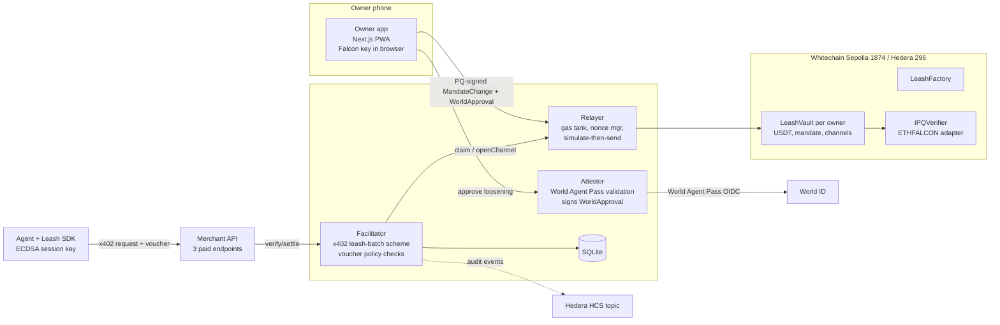

# CLAUDE.md — Leash (ETHGlobal Mumbai 2026)

> **Read this whole file at the start of every session.** Sections 0–13 are the fixed spec. You keep **§14 Project Memory** up to date. That section is how this project remembers decisions, addresses and progress across sessions.
> Items marked **VERIFY** are unconfirmed assumptions. Check each one, then log the result in §14.
> Items marked **HUMAN** need the human (funds, accounts, credentials, a judgment call). Ask, don't guess.

---

## 0. How you work on this repo

1. **Session start:** read §14, run `pnpm status` once it exists, then continue the current milestone from §11.
2. Keep a task list per milestone and tick items as they finish.
3. **Commit small and often** (every meaningful step, at least every 45 minutes), using conventional messages (`feat(vault): …`, `test(facilitator): …`). Never squash, never force-push, never make one giant commit. Judges check commit history.
4. Run the relevant tests before every commit. Don't commit with failing tests unless the commit message says `wip:` and states why.
5. **Never commit secrets.** Keep `.env*` in `.gitignore` from the first commit, and ship `.env.example` with placeholder values.
6. When a gate in §11 fails or you're blocked for more than 30 minutes, take the listed fallback, log it in §14, and keep going.
7. **At the end of every milestone, at every gate, and whenever the human types `status`:** regenerate `LEASH_STATUS.md` (§12). The human sends that file to their reviewer, so it must be honest and complete.
8. Prefer boring, well-tested code over clever code. This project's main claim is safety.

---

## 1. Hackathon rules (hard constraints)

- **Track: From Scratch.** All code is written during the event. (The original "Nov 6–8" dates were wrong; the human confirmed on 2026-11-05 23:30 IST that hacking is open.)
- **Never copy code from 0xGasless or any private repo**, even though the team wrote it. Writing the same patterns fresh from knowledge is fine.
- **Allowed:** public open-source packages, listed in the README: viem, @x402/core, @x402/evm, @x402/hedera, OpenZeppelin, Foundry/forge-std, ZKNox ETHFALCON (and ETHDILITHIUM as a fallback), @hashgraph/sdk, Next.js, Tailwind, Hono, better-sqlite3, vitest, jose.
- **AI use must be disclosed in the README** (Claude Code built most of the code from this spec, which was drafted the night before kickoff; no code was pre-written).
- **License:** MIT. The repo is public.
- **Partner prize picks (max 3):** Whitechain "Scale · Payments Nobody Notices", World "World ID Agent Pass" (the $5k non-Continuity prize), Hedera "AI Agents That Pay: x402 on Hedera".

---

## 2. What we're building

**Problem (one line):** AI agents now spend money on their own, but their spending limits are enforced where the agent itself can reach, and the keys behind those limits won't survive quantum computers.

**Description:**
1. Leash is an x402 payment rail where agents pay per request through batched payment channels on Whitechain, in USDT, without ever holding gas.
2. Each payment is checked against an onchain spending mandate (cap, merchants, expiry). Only the owner's post-quantum (Falcon) key can loosen the mandate, and only after a fresh World ID Agent Pass human check.
3. Agents use short-lived session keys whose worst case is capped by the mandate, so post-quantum cost is paid only on rare owner actions. That is about 870× less signature data than signing every payment post-quantum.

**Why now (for the README and pitch):**
- A Cornell Tech / Yale study published this week found 9 of 10 frontier models raised their own Circle agent-wallet spending caps by reading the emailed approval code. Lesson: approval must be bound to an action the agent cannot perform.
- x402 batch settlement went live on Solana (Oct 2026) but is thin on EVM L2s. Agent-signed vouchers have no per-request checkpoint.
- On-chain post-quantum verification costs ~1.2–1.8M gas. Ethereum ranked PQ precompiles C-tier for its Hegotá fork, so the account layer has to handle it, and only cheap L2s like Whitechain make that affordable today.

**Design rule:** post-quantum keys where keys live long; cheap ECDSA where exposure is limited in time and value. **Loosening** risk (raising caps, adding merchants, withdrawing, rotating keys) needs the owner's post-quantum signature plus a World approval. **Tightening** risk (revoke, lower caps) needs only the owner's post-quantum signature, and a session key may always revoke itself.

**Data math for the dashboard** (the article's workload: 10,000 agents × 1 paid request/min = 14.4M requests/day; signature bytes only):
- Post-quantum per payment: 14.4M × 2,420 B (ML-DSA-44) ≈ **34.8 GB/day**
- Leash: hourly cumulative claims 240k × 65 B ≈ 15.6 MB, plus one post-quantum owner action per agent per day 10k × 2,420 B ≈ 24.2 MB → ≈ **40 MB/day** → **~870× less**
- The dashboard must also compute the *live* version from real counts: vouchers served vs. claim transactions and their calldata bytes.

---

## 3. Prize requirements (build to these checklists)

### 3.1 Whitechain — Scale · Payments Nobody Notices ($2k / $1k)
- [ ] Contracts deployed on **Whitechain Sepolia (chain ID 1874)** and **verified** on explorer.testnet.whitechain.io
- [ ] At least one payment in **USDT `0xcedfB56113143d55b2358b8CFbB0dEB5Ad2f55a7`** settled in the main flow, with the explorer link in the README. A self-minted token doesn't count.
- [ ] README line: why this flow needs onchain stablecoin settlement on Whitechain, and what a normal payment rail couldn't do
- [ ] The payer (agent) never holds WBT, never sees a seed phrase, never picks a chain. Show it in the demo.
- [ ] Explain: who pays gas, how the relayer gets its WBT, what stops draining (§8.4)
- [ ] Steady commit history; README covers setup, architecture and current limitations
- [ ] 2–4 minute demo video showing every party: owner, agent, merchant, relayer
- [ ] `WHITECHAIN_FEEDBACK.md`: honest notes on what worked, where we got stuck, what the docs were missing
- **Won't place:** payers who sign gas-paying transactions; AI chats that never actually pay

### 3.2 World — World ID Agent Pass ($2.5k / $1.5k / $1k)
- [ ] Uses the official World ID Agent Pass (docs: https://auth.world.org/docs, portal: https://auth.world.org/portal). Proofs are mocked for the hackathon (fake identities), so don't rely on them in production.
- [ ] The complete journey: verification request → user completes it → result validated → protected action executes (mandate loosened onchain)
- [ ] **Denied / expired / cancelled path where the protected action does not happen.** Demo it.
- [ ] Validation happens in a secure backend. No client secrets exposed, and an unvalidated client response is never treated as authorization.
- [ ] `WORLD_DEBRIEF.md`: time to first success, friction, missing capability or docs, the single most valuable improvement
- Known friction from other builders: the web Simulator's security policy blocks the Agent Pass sandbox bridge, so test with the iOS sandbox app or mocked proofs.

### 3.3 Hedera — AI Agents That Pay: x402 on Hedera ($3k / $2k / $1.5k)
- [ ] At least one x402-protected endpoint that settles on Hedera testnet through a facilitator we run
- [ ] An agent finds the endpoint and completes at least one paid request end to end with **no human approving**
- [ ] README covering setup, architecture and the payment flow, including the **Hedera transaction ID** of a settled payment
- [ ] Demo video ≤ 5 minutes showing settlement and linking to HashScan
- Extra points we hit: spending controls (budgets, per-merchant limits, allowlists), human approval above a threshold, an **HCS topic as a tamper-evident audit log**, settling in an HTS token (USDC)

### 3.4 ETHGlobal general
- [ ] Public repo, MIT license, AI usage disclosed, steady commits, demo video, live demo link

---

## 4. Architecture



**Trust model (state it honestly in the README):**
- **Enforced by contract:** funds locked per channel, voucher ≤ locked amount, session expiry/revocation, merchant allowlist, per-merchant caps, mandate-change signatures.
- **Enforced by facilitator (off-chain):** per-request price check, hourly rate limits, gas-tank budgets.
- **Trust points:** the attestor key (it vouches for World validation) and the relayer (liveness only; it can't steal funds because every action needs a valid signature).
- **Worst case if an agent session key leaks or is broken by a quantum computer:** the attacker can only overpay the *already-allowed* merchant, up to the locked channel amount, before the session expires.

---

## 5. Repo layout (pnpm monorepo)

```
/contracts            Foundry: LeashFactory, LeashVault, verifiers, tests, deploy scripts
/packages/sdk         TS: EIP-712 types, voucher/session signing, x402 client wrapper (wrapFetch)
/packages/facilitator TS (Hono): x402 /supported /verify /settle, channel + policy engine, batcher
/packages/relayer     TS: gas tank, nonce manager, simulate-then-send, budgets (imported by facilitator)
/packages/hedera      TS: HCS topic logger, Hedera deploy helpers, token association
/apps/web             Next.js owner app (mobile-first PWA) + API routes for the attestor
/apps/merchant        Hono demo merchant with 3 x402-paid endpoints
/apps/agent           Demo agent (scripted research agent + prompt-injection scenario)
/scripts              status.sh (writes LEASH_STATUS.md), env checks, demo seeders
/docs                 DEMO_SCRIPT.md, architecture notes
README.md  WHITECHAIN_FEEDBACK.md  WORLD_DEBRIEF.md  LEASH_STATUS.md  LICENSE
```

Root scripts: `pnpm test` (forge + vitest), `pnpm dev` (all services), `pnpm status` (→ `scripts/status.sh`), `pnpm deploy:whitechain`, `pnpm deploy:hedera`.

---

## 6. Contracts

Solidity ^0.8.24, OpenZeppelin, `SafeERC20` everywhere (**USDT-style tokens may not return bool**), `ReentrancyGuard`, custom errors, events for everything the dashboard shows.

### 6.1 `IPQVerifier`
```solidity
interface IPQVerifier {
    function scheme() external pure returns (bytes32);  // e.g. keccak256("ETHFALCON-512")
    function verify(bytes calldata pubKey, bytes32 digest, bytes calldata sig) external view returns (bool);
}
```
- `EthFalconVerifier`: adapter around ZKNox `ZKNOX_ethfalcon` (repo: github.com/ZKNoxHQ/ETHFALCON). Read its README and specs and adapt to its exact verify signature and key/signature encoding (pubkey is an NTT-packed `uint256[32]`). **VERIFY** the gas on Whitechain; expected ~1.8M.
- `MlDsaVerifier`: fallback adapter (ZKNox ETHDILITHIUM or another public ML-DSA-44 verifier). Build it only if the gate in §11 needs it.
- `MockPQVerifier` (tests and local only; never deployed to a testnet): accepts an ECDSA signature so unit tests stay fast. **Never wire it into the factory config of a public deployment.**
- The verifier address is part of the vault config, and changing it is a loosening action (§6.3). That gives an upgrade path for new cryptography, which the article asks for.

### 6.2 `LeashFactory`
- Deploys per-owner vaults as **EIP-1167 clones with CREATE2** (`Clones.cloneDeterministic`), salt = `keccak256(pqPubKeyHash, worldSubjectHash)`.
- `predictVault(salt)` gives the counterfactual address. **This is the owner's deposit address:** USDT can be sent there before deployment, so the owner never makes a gas-paying transaction.
- `createVault(InitConfig cfg, bytes pqPubKey, bytes pqSig, WorldApproval wa, bytes attestorSig)`: checks the PQ signature over the init config and the attestor approval, then deploys and initializes.
- Global config (owner-of-factory = deployer, settable once at deploy): `token`, `attestor`, `relayerFeeRecipient`, `claimFee` (fixed USDT fee, e.g. 0.001), `defaultVerifier`.

### 6.3 `LeashVault`
State:
- `pqPubKeyHash` (keccak of the Falcon pubkey; pass the pubkey in calldata and check the hash, since storing 1 KB is expensive), `verifier`, `worldSubjectHash`, `mandateNonce`
- `sessions[address] = { uint64 expiry; uint128 cap; uint128 locked; uint128 spent; bool revoked; }`
- `merchants[address] = { bool allowed; uint128 dailyCap; uint128 spentToday; uint64 dayStart; uint128 maxChannel; }`
- `channels[bytes32] = { address session; address merchant; uint128 locked; uint128 claimed; uint64 expiry; bool closed; }`

Functions:
- `openChannel(OpenChannel req, bytes sessionSig)` — called by anyone (normally the relayer). Session-key signed. Checks: session active, merchant allowed, amount ≤ maxChannel, within session cap, within merchant daily cap, vault balance sufficient. Locks funds. Emits `ChannelOpened`.
- `claim(bytes32 channelId, uint256 cumulativeAmount, bytes voucherSig)` — callable by anyone. Checks: voucher signed by the channel's session key, `cumulativeAmount > claimed`, `cumulativeAmount ≤ locked`, channel not closed. Pays `delta - fee` to the merchant and `fee` to `relayerFeeRecipient` (fee only if `msg.sender` is the relayer; if the merchant self-claims, no fee). Emits `Claimed(channelId, delta, cumulativeAmount)`.
- `closeExpired(bytes32 channelId)` — after `expiry + GRACE`, returns the unclaimed lock to the vault.
- `cooperativeClose(bytes32 channelId, uint256 finalAmount, bytes merchantSig)` — merchant releases the rest early.
- `applyChange(MandateChange c, bytes pqPubKey, bytes pqSig, WorldApproval wa, bytes attestorSig)`:
  - Checks `keccak256(pqPubKey) == pqPubKeyHash`, `verifier.verify(pqPubKey, digest(c), pqSig)`, `c.nonce == mandateNonce`, and `c.deadline ≥ now`.
  - **If `c.action` is loosening** (`ADD_SESSION`, `RAISE_SESSION_CAP`, `SET_MERCHANT` with higher limits, `WITHDRAW`, `ROTATE_PQ_KEY`, `SET_VERIFIER`): also require `wa.changeHash == digest(c)`, `wa.vault == this`, `wa.worldSubjectHash == worldSubjectHash`, `wa.deadline ≥ now`, `wa.nonce == mandateNonce`, and attestor signature valid.
  - **If tightening** (`REVOKE_SESSION`, lower limits, `REMOVE_MERCHANT`): the PQ signature alone is enough, and `wa` may be empty.
  - Increments `mandateNonce`. Emits `MandateChanged(action, nonce)`.
- `revokeSelf()` — `msg.sender` is a session key; revokes itself.
- No `owner`-only ECDSA function exists anywhere. **The only root authority is the PQ key.**

### 6.4 Foundry tests (must exist and pass before M3)
voucher replay with lower cumulative → revert · cumulative > locked → revert · wrong session signer → revert · expired / revoked session → revert · open beyond session cap / merchant daily cap / maxChannel → revert · merchant not allowed → revert · loosening change without WorldApproval → revert · stale WorldApproval (deadline) → revert · WorldApproval bound to a different change hash → revert · mandate nonce replay → revert · wrong PQ pubkey → revert · invalid PQ sig (real ETHFALCON vector) → revert · tightening change with PQ only → succeeds · closeExpired returns funds · cooperativeClose math · claim fee math (relayer vs. self-claim) · token without bool return (mock USDT) works via SafeERC20 · reentrancy attempt via malicious token → revert · counterfactual deposit, then createVault → balance visible · fuzz: random voucher sequences never pay more than locked.

Also a **gas report** (`forge test --gas-report`) whose numbers go into §14 and the README.

---

## 7. EIP-712 (domain: name `"Leash"`, version `"1"`, chainId, verifyingContract = vault; factory init uses verifyingContract = factory)

```
OpenChannel(address vault,address merchant,uint256 amount,uint64 expiry,uint256 sessionNonce)
Voucher(bytes32 channelId,uint256 cumulativeAmount)
MandateChange(uint8 action,bytes data,uint256 nonce,uint64 deadline)
WorldApproval(address vault,bytes32 changeHash,uint256 nonce,bytes32 worldSubjectHash,uint64 authTime,uint64 deadline)
InitConfig(bytes32 pqPubKeyHash,bytes32 worldSubjectHash,address verifier,bytes initialMandate)
```
- `channelId = keccak256(vault, session, merchant, sessionNonce)`.
- The Falcon signature is over the **EIP-712 digest (bytes32)**. Match ETHFALCON's message encoding exactly; write a cross-check test where a vector signed off-chain verifies on-chain.
- The SDK exports all types and digest helpers, and the contracts and SDK share test vectors (`/contracts/test/vectors/*.json`).

---

## 8. Facilitator, relayer, x402 scheme

### 8.1 x402 scheme `leash-batch`
- Follow x402 v2 transport (header names per the current spec at github.com/x402-foundation/x402. **VERIFY:** `PAYMENT-REQUIRED` on the 402 response, `PAYMENT-SIGNATURE` on the retry, `PAYMENT-RESPONSE` on success). Model the semantics on the official `batch-settlement` scheme spec (`specs/schemes/`); read it first.
- Use `@x402/core` types and register a custom scheme if its interfaces allow it. If they fight you for more than 45 minutes, implement the headers directly and log the friction for the feedback files.
- `PaymentRequirements.extra = { vault?: hint, minChannel, facilitatorUrl }`, network `eip155:1874` (and `eip155:296` for Hedera), asset = USDT (or Hedera USDC), `payTo` = merchant, price in atomic units.
- Client payload: `{ vault, session, channelId, cumulativeAmount, voucherSig }`.

### 8.2 `/verify` and `/settle`
- `/verify`: recover the session signer, load the channel (onchain read with a 2-second cache), check `cumulative - lastAccepted ≥ price`, `cumulative ≤ locked`, session active, merchant matches, rate limit OK. Return a reason code on failure.
- `/settle`: atomically store the latest voucher per channel (SQLite transaction, **serialize per channel** to avoid races) and return success with `{ channelId, cumulativeAmount, pendingClaim: true }`. Settlement is deferred to the batcher.
- **No open channel?** The SDK calls `POST /channels/open` with a session-signed `OpenChannel`, and the relayer submits `openChannel` (counts against the vault's op budget).
- **Batcher:** claims when the unclaimed amount ≥ threshold, or every N seconds, or when the channel is near expiry. One claim carries only the latest cumulative voucher.

### 8.3 Relayer
- One hot key per chain, from env. **Simulate every transaction with `eth_call` first and never send one that would revert**, so attackers can't burn our gas with failing transactions.
- Nonce manager with a mutex and a retry/replace policy on stuck transactions; gas price = max(base fee × 2, floor). Whitechain minimum base fee is 5 gwei.
- Exposes `GET /gas-tank`: WBT balance, spent today, budget per merchant/vault, an estimate of how many operations are left.

### 8.4 Anti-drain answer (README section; Whitechain judges asked for exactly this)
1. **Who pays gas:** the relayer. Each claim carries a USDT `claimFee` to the relayer's fee recipient, so the merchant funds the gas out of revenue. `openChannel` counts against a per-vault op budget.
2. **How the relayer gets WBT:** team-funded from the faucet for the hackathon. In production, the claim fees accrue as USDT and get swapped to WBT on a schedule (describe it; it doesn't need to be built).
3. **What stops draining:** simulate-before-send (no reverting transactions) · per-merchant and per-vault op budgets · rate limits per IP/session/vault · refuse claims whose delta < `k × estimated gas cost` · only relay calls to known contracts and selectors · an alert at a low tank balance plus auto-pause.
- vitest tests: concurrent vouchers on the same channel (ordering), nonce manager under 20 parallel sends, a reverting simulation is refused, budget exhaustion → 429, rate limit → 429, uneconomic claim deferred.

---

## 9. Apps

### 9.1 Owner app (`/apps/web`, Next.js + Tailwind, mobile-first PWA, works on desktop)
Screens:
1. **Onboard:** link World ID (Agent Pass) → generate the Falcon keypair in the browser (WASM, stored in IndexedDB, with an export-backup button) → show the counterfactual vault address as a QR code ("send USDT here") → create the vault (PQ-sign InitConfig; the relayer deploys it).
2. **Mandate:** sessions (create with expiry and cap; revoke), merchants (allow, daily cap, max channel).
3. **Approvals inbox:** pending loosening requests (e.g. an agent asking for a higher cap) → *Approve* runs the World Agent Pass check, then the Falcon signature, then submission → shows the tx link. *Deny* records the denial and nothing changes onchain.
4. **Activity:** channels, vouchers served, claims with explorer/HashScan links, HCS audit log entries.
5. **Stats:** live data reduction (requests vs. claim transactions, bytes) next to the §2 projection; gas tank.

**Falcon signing in the browser:** compile a Rust ETHFALCON-compatible signer to WASM (candidates: the `fn-dsa` crates with the eth_falcon variant, `tectonic-bedrock` with the `sign` feature). Gate in §11. **Fallback:** a local `owner-signer` service built on the ETHFALCON Python signer, called by the app over localhost. Document it as a limitation.

### 9.2 Attestor (Next.js API routes inside `/apps/web`; server-only secrets)
- World ID Agent Pass via its **OIDC flow** (from other builders: device flow; the `device_code` stays on the server; poll respecting `interval`/`slow_down`/expiry). Read https://auth.world.org/docs and follow it exactly; it overrides anything here.
- Validate the ID token with `jose`: signature (JWKS), `iss`, `aud` = our client, `exp`, **`auth_time` > the time this approval attempt started** (proves the check is fresh), nonce/state, and the assurance level. Map the World subject to `worldSubjectHash` (the first link binds it; one World subject per vault).
- Only then sign the `WorldApproval` with the attestor key (EIP-712).
- **Cancelled, denied or expired:** no signature, the attempt is marked `DENIED/EXPIRED`, and the agent stays capped. **This is the denied path World requires; show it in the demo.**
- An attempt is single-use and bound to one `changeHash`.

### 9.3 SDK (`/packages/sdk`)
`createSession()`, `signOpenChannel()`, `signVoucher()`, `wrapFetchWithLeash(fetch, { session, vault, facilitator })`, which handles 402 → open a channel if needed → sign a cumulative voucher → retry. Plus `requestLoosening({ action, data, reason })`, which posts to the owner's approvals inbox (the agent can *ask*, never *approve*).

### 9.4 Merchant demo (`/apps/merchant`)
Three paid endpoints with different prices: `/quote` (FX quote, 0.01 USDT), `/translate` (0.02), `/summarize` (0.05). Each is protected by x402 `leash-batch` through our facilitator. Expose a discovery endpoint `/.well-known/x402` (or the format the x402 spec defines; **VERIFY**) so the agent *finds* the endpoints rather than hard-coding them (Hedera requires discovery).

### 9.5 Demo agent (`/apps/agent`)
- **Scenario A (happy path):** the agent discovers endpoints, completes 300–500 paid calls across three merchants within its mandate, the batcher claims, and explorer links print.
- **Scenario B (Cornell replay):** a "malicious invoice" in the agent's inbox tells it to raise its own limit. The agent (1) tries `applyChange` directly with its session key → contract revert, then (2) calls `requestLoosening` → the owner gets an approval request → the owner **denies** → no attestation → the agent stays capped. Then repeat with the owner **approving** → limit raised onchain.
- **Scenario C (quantum-bounded leak):** simulate a leaked session key: the attacker can only pay the allowed merchant up to the locked amount, then the owner revokes with a PQ-only tightening change.
- The LLM is optional (OpenAI-compatible env var). The scenarios must run scripted without an LLM, so the demo can't fail on model behavior.

---

## 10. Hedera port (M7, only after the hour-20 gate passes)
- Network: Hedera testnet EVM, chain ID 296, JSON-RPC relay (e.g. `https://testnet.hashio.io/api`, **VERIFY**). Explorer: HashScan testnet.
- Token: testnet USDC (HTS) through its ERC-20 facade. Its token ID and EVM address are **VERIFY** items; get test USDC from Circle's faucet (Hedera Testnet).
- **HTS gotcha:** contracts and accounts must be *associated* with an HTS token before they can receive it. In the vault initializer, call the HTS precompile at `0x167` `associateToken(address(this), token)` (Hedera-only code path behind a flag), and associate the merchant and fee-recipient accounts via `@hashgraph/sdk`.
- **VERIFY** that the per-transaction gas limit covers the Falcon verify (~1.8M) and that ETHFALCON fits the contract size limit.
- **HCS audit log:** create one topic and have the facilitator publish `{event, vault, channelId, amount, txHash, ts}` for ChannelOpened, Claimed, MandateChanged and denials. Link the topic in the README and dashboard.
- **Fallback if the Hedera EVM port stalls for more than 3 hours:** serve one Hedera endpoint with the standard **`exact` scheme** through our own facilitator (`@x402/hedera` reference implementation; the facilitator pays fees), with the mandate check done in the facilitator and logged to HCS. Weaker, but it qualifies. Be honest about it in the README.

---

## 11. Milestones, gates, fallbacks

| # | Hours | Milestone | Done when |
|---|---|---|---|
| M0 | 0–1 | **Environment checks** (no product code yet) | §14 records: RPC OK; USDT decimals and source of test USDT (**HUMAN** if the faucet/bridge doesn't provide it); whether USDT has `DOMAIN_SEPARATOR`/permit/EIP-3009 (informational; the design doesn't need them); whether the ERC-4337 EntryPoint `0x0000000071727De22E5E9d8BAf0edAc6f37da032` has code (informational); relayer WBT balance; ETHFALCON deployed on Whitechain + measured verify gas |
| M1 | 1–6 | Contracts core + full test suite with `MockPQVerifier` | §6.4 green, gas report saved |
| M2 | by **h4** | **GATE: real Falcon verify works on Whitechain** with an off-chain-signed vector | Pass → keep. Fail → ML-DSA adapter. Fail again → passkey/ECDSA owner key + PQ module kept as a tested library; adjust the README story. Log it. |
| M3 | 4–12 | Relayer + facilitator + merchant + SDK, end-to-end on Whitechain with **real USDT** | First `Claimed` tx link in §14 and README |
| M4 | 8–14 | Attestor + World Agent Pass + `applyChange` loosening, denied path | Approve tx link + denied attempt logged |
| M5 | 10–18 | Owner app (all screens), **GATE h6 Falcon WASM signing** | Pass → in-browser keys. Fail → local owner-signer fallback, logged |
| M6 | 14–20 | Demo agent scenarios A/B/C + dashboard stats | All three run scripted, back to back |
| — | **h20** | **GATE: is Whitechain + World complete end to end?** | Yes → M7. No → skip Hedera EVM; do the §10 fallback only if time allows; polish the core |
| M7 | 20–28 | Hedera port + HCS log | HashScan tx of a settled claim + topic link |
| M8 | 28–34 | README (per-sponsor sections), `WHITECHAIN_FEEDBACK.md`, `WORLD_DEBRIEF.md`, `docs/DEMO_SCRIPT.md`, contract verification, deploy the web app (live link) | §13 checklist all ticked |
| M9 | 34–36 | **Code freeze**, video recording support, final `LEASH_STATUS.md` | Submitted |

---

## 12. Status report protocol — `LEASH_STATUS.md`

`scripts/status.sh` (wired to `pnpm status`) must collect the automatic parts. Then **you** fill in the narrative parts and overwrite `LEASH_STATUS.md` at the repo root. Always use exactly this template:

```markdown
# LEASH_STATUS — <ISO timestamp IST> — milestone <M#> (<done|in progress|blocked>)

## 1. Summary (3 lines max)
## 2. Gates
| Gate | Result | Evidence | Fallback taken |
## 3. Deployments
| Chain | Contract | Address | Verified? | Explorer link |
## 4. Live proof (most recent)
- Whitechain USDT claim tx: <link>  | amount | vouchers covered
- Mandate loosening (approved) tx: <link>
- Denied approval attempt id + reason:
- Hedera claim tx / HashScan: <link> | HCS topic: <link>
## 5. Tests
- forge: <passed>/<total>, failures listed verbatim
- vitest: <passed>/<total>, failures listed verbatim
- Gas: openChannel / claim / applyChange (PQ) / createVault
## 6. Metrics
- vouchers served / claim txs / onchain calldata bytes / reduction factor
- relayer WBT left / est. ops remaining
## 7. Prize checklists (copy §3 with current ticks)
## 8. Known issues & risks (honest; include anything mocked or faked)
## 9. Decisions since last report
## 10. Questions for the reviewer
## 11. Commit log since last report (git log --oneline)
```

Rules: never claim something works without a link, a test result or command output as evidence. Mark anything mocked as **MOCKED**. If a check couldn't run, say so.

---

## 13. Submission checklist (M8)
- [ ] README: problem, the 3-line description, architecture diagram, trust model, the §2 data math with live numbers, setup in under 10 commands, **one section per sponsor** pointing to files and lines, deployed addresses, tx links, limitations, AI-usage disclosure, public dependency list, and the line "patterns informed by the team's prior work; all code written during ETHGlobal Mumbai"
- [ ] `WHITECHAIN_FEEDBACK.md` · `WORLD_DEBRIEF.md` · `LICENSE` (MIT)
- [ ] Contracts verified on the Whitechain explorer (and HashScan where applicable)
- [ ] Live web demo URL
- [ ] `docs/DEMO_SCRIPT.md`: a 3:30 cut that serves all three sponsors (Whitechain 2–4 min, Hedera ≤ 5 min). Order: problem hook (Cornell stat) → owner onboarding (deposit address, no gas) → agent pays 300+ calls → one claim tx → Scenario B denied, then approved → leaked key bounded + revoke → Hedera HashScan + HCS → data-reduction number
- [ ] Final `LEASH_STATUS.md` with every checklist ticked or explained

---

## 14. Project Memory (living — keep updated; newest first within each list)

### Current state
- Milestone: **M1 done** (forge green). **M2 gate PASS on deployed contracts** (2026-11-06): verified EthFalconVerifier on 1874 returns true for off-chain Falcon sigs over Leash digests (`contracts/test/vectors/falcon_leash.json`), false for wrong digest, ~1.58M gas. **M3 in progress**: sdk + relayer + facilitator + merchant done and green on anvil e2e (30 paid calls → 3 claims); next = run it on Whitechain with real USDT.
- **M4**: attestor + approvals + denied path DONE with `WORLD_MODE=mock` (MOCKED World issuer); real World IdP code path written (device grant) but untested until the portal app exists (HUMAN). **M5**: owner app (5 screens) builds; **gate h6 Falcon WASM: PASS** (in-browser keys; localhost Python signer kept as alt).
- Live on 1874: vault `0x3B77877490A4C2A89e55b94e969cae1fA190c392` (CLI bootstrap, World MOCKED) created `0x82290b8e…d298`; Scenario B approve → cap 5→8 `0x36e2e143…c1ab`; deny path → no tx (approval a4a047c2…); Scenario C attacker open → 422 MerchantNotAllowed (simulated, never sent).
- Next action: human sends USDT to the vault → `pnpm agent a` → first `Claimed` tx. Meanwhile: README/feedback docs, status script, Hedera.
- Blockers (HUMAN): (1) USDT for the vault; (2) World IdP sandbox app registration (client id/secret) + a sandbox World ID or the hackathon's mocked-proof environment; (3) Hedera testnet account (portal.hedera.com) for M7.
- Run locally: `pnpm facilitator` · `pnpm merchant` · `pnpm owner-signer` · `WORLD_MODE=mock pnpm web` · `pnpm agent a|b|c` · `pnpm owner status|approvals|approve|deny|revoke-session`.
- Keys live in `.env` (gitignored, generated 2026-11-05). Falcon keys in `keys/` (gitignored). Python signer venv: `tools/owner-signer/.venv` (numpy, pycryptodome, eth_abi, polyntt @ ZKNoxHQ/NTT 3ac5f5d).
- Research notes: `docs/research/x402.md`, `docs/research/world-idp.md` — read these before touching x402 or World code.

### Decision log
- 2026-11-05 — World: use the World IdP **device grant** (RFC 8628) from the attestor backend; bind the action server-side (IdP has no binding_message/CIBA). Validate `auth_time ≥ attempt start`, `amr ∋ "pop"`, acr orb/orb-face, pinned `sub`. Sandbox issuer `https://sandbox.auth.world.org`. Offline/dev: `WORLD_MODE=mock` with a local RS256 JWKS (labelled MOCKED).
- 2026-11-05 — x402: headers confirmed (`PAYMENT-REQUIRED` / `PAYMENT-SIGNATURE` / `PAYMENT-RESPONSE`, base64 JSON). Implement `leash-batch` as @x402/core `SchemeNetwork{Client,Server,Facilitator}`; facilitator must list `leash-batch`+`eip155:1874` in `/supported` before merchants start. Discovery: merchant `/.well-known/x402` (IETF draft format) + facilitator `/discovery/resources`.
- 2026-11-05 — Hedera plan: the spec §10 fallback (`exact` scheme via `@x402/hedera`, HTS USDC `0.0.429274`, our facilitator as fee payer, mandate checks in facilitator + HCS log) is the primary Hedera path; EVM vault port only if time allows. Note: official x402 batch-settlement contract is live on Hedera testnet 296.
- 2026-11-05 — Spec deviations (deliberate): `cooperativeClose(channelId, finalAmount, voucherSig, merchantSig)` (extra voucherSig so the merchant can't close above what the session signed); new EIP-712 types `CloseChannel(bytes32 channelId,uint256 finalAmount)` and `RevokeSession(address session)` (gasless self-revoke via `revokeSessionBySig`); factory has an extra `relayer` immutable (claim fee only when `msg.sender == relayer`); `createVault` only accepts `defaultVerifier` (prevents squatting a victim's counterfactual address with a permissive verifier); `MAX_AUTH_AGE = 1h` onchain check on `WorldApproval.authTime`; `GRACE = 15 min`; merchant daily cap counts amounts *locked* per UTC day; claims stay valid after session revocation (merchant already served); BATCH action (no nesting) so onboarding/approvals need one World check.
- 2026-11-05 — Daily cap / session cap semantics: `locked + spent ≤ cap`; closing returns unclaimed lock to the session's headroom.
- 2026-11-05 — `EthFalconVerifier` adapter will call ZKNox's **4-arg pure** `verify(bytes h, bytes salt, uint256[] s2, uint256[] ntth)`, not its ERC-7913 `verify(bytes key, bytes32, bytes)`, because the 7913 variant takes `key` = 20-byte SSTORE2 pointer (pubkey must be stored onchain first via `setKey`). The 4-arg form keeps §6.3's "pubkey in calldata, check keccak against `pqPubKeyHash`". Adapter must pre-check lengths / try-catch: 4-arg verify **reverts** (not false) on salt≠40 B, s2≠32 words, ntth≠32 words. Sig encoding to standardise on: salt(40 B) ‖ s2(32×32 B) = 1,064 B; pubkey = abi `uint256[32]` (1,024 B).
- 2026-11-05 — Use `https://rpc.testnet.whitechain.io` (chain 1874). NOT `rpc-testnet.whitechain.io`, which is the old testnet (chain 2625).
- 2026-11-05 — Contract verification via Blockscout (`forge verify-contract --verifier blockscout --verifier-url https://explorer.testnet.whitechain.io/api/`). VERIFY at M8 with a real deploy.
- 2026-11-05 — Track: From Scratch. No 0xGasless code copied; patterns rewritten fresh.
- 2026-11-05 — Prize picks: Whitechain Scale, World Agent Pass, Hedera x402.
- 2026-11-05 — Own vault + relayer instead of ERC-4337/7702/permit, to remove chain dependencies.

### VERIFY results
| Item | Result | Date |
|---|---|---|
| Whitechain RPC | `https://rpc.testnet.whitechain.io` → chainId 1874, head ≈ block 12,304,514, client `op-reth/v2.8.1` (OP Stack L2), block gas limit 40M, base fee 5 gwei | 2026-11-05 |
| Whitechain EVM version | PUSH0, TSTORE/TLOAD, MCOPY, BLOBBASEFEE all execute → `evm_version = cancun` safe. GasPriceOracle `isIsthmus()` = true | 2026-11-05 |
| Whitechain RPC state overrides | `eth_call` + `eth_estimateGas` accept a state-override object (lets us measure gas without deploying) | 2026-11-05 |
| Whitechain explorer | Blockscout (`/api/v2/*` and Etherscan-style `/api` both 200 JSON) | 2026-11-05 |
| USDT `0xcedf…55a7` | name "Tether USD", symbol USDT, **decimals 6**, totalSupply 1,945,273 USDT. EIP-1967 proxy → impl `0x26425662d126412128967ecf0a02ec48573026f7` | 2026-11-05 |
| USDT `transfer` return | returns `true` (32-byte bool) in eth_call. Still use SafeERC20 per §6. | 2026-11-05 |
| USDT permit / EIP-3009 (informational) | impl has `permit` (EIP-2612), `DOMAIN_SEPARATOR` (0xcdcf…2a25), `nonces`; **EIP-3009 present** (`transferWithAuthorization` v,r,s and bytes-sig variants, `receiveWithAuthorization`); no `eip712Domain()`. Design doesn't need them. | 2026-11-05 |
| USDT test-token source | impl has `mint(address,uint256)` but no public faucet fn; owner is `0x8790832Ba493Cc16a4dBC5c961B0C4950632799c`. Source still **HUMAN** (faucet/booth). | 2026-11-05 |
| WBT faucet | https://faucet.testnet.whitechain.io — GitHub OAuth (≥30-day account) + Turnstile captcha → 2 WBT/24h. Not scriptable → **HUMAN**. | 2026-11-05 |
| USDT via swap (option) | Builders swap WBT→USDT on undocumented Uniswap V3: WWBT `0x4200…0006`, SwapRouter02 `0xe208cC685cD95D56E8ec6DEC9816476567fc6962`, pool `0x5645101Ca8d2F7BaBC27b10359555767a1BdF999` (~2 WBT → ~147 USDT). Details docs/research/whitechain-hedera.md | 2026-11-05 |
| Hedera clone HTS association | **Known issue (source-read):** `0x167.associateToken` from a clone (delegatecall) is rejected → switch `_htsAssociate` to `IHRC719(token).associate()` before any Hedera EVM deploy. Contracts may auto-associate anyway (max_auto_assoc = -1 observed). | 2026-11-05 |
| Hedera SDK | `@hiero-ledger/sdk` 2.90.1 (renamed `@hashgraph/sdk`); per-tx gas cap 15M | 2026-11-05 |
| ERC-4337 EntryPoint v0.7 (informational) | has code (16,035 B). Also present: CREATE2 deployer `0x4e59…956C`, Multicall3 `0xcA11…CA11` | 2026-11-05 |
| ETHFALCON verify on Whitechain | **PASS via state override** (not yet a real deployment): ZKNox `ZKNOX_ethfalcon` @ commit `43ac863` (2026-10-21), solc 0.8.25, runtime 6,985 B (< EIP-170). Vectors 0–2 from `test/ethfalcon.t.sol`: valid → `true`, tampered message → `false`. | 2026-11-05 |
| ETHFALCON real deployment on Whitechain | **DONE + verified** `0x4b92…D2bB` (ZKNox) behind `EthFalconVerifier 0x78Cd…B7cB`; M2 gate PASS against the deployed contract | 2026-11-06 |
| Off-chain Falcon sig over **Leash EIP-712 digests** verifies on Whitechain node | **PASS** (state override): init/change0/change1 digests from `contracts/test/vectors/falcon_leash.json` → `true`, tampered → `false` | 2026-11-05 |
| x402 v2 header names | **CONFIRMED** `PAYMENT-REQUIRED` (402), `PAYMENT-SIGNATURE` (retry), `PAYMENT-RESPONSE` (success); base64 JSON; @x402/* 2.30.0 | 2026-11-05 |
| x402 discovery format | No normative `/.well-known/x402`; official = Bazaar extension + facilitator `GET /discovery/resources`; `.well-known/x402` only in IETF draft-hawkins-x402-dns-discovery-03 | 2026-11-05 |
| World Agent Pass | = World IdP (auth.world.org). Flows: auth code+PKCE, device grant. No CIBA/binding_message. RS256, pairwise sub. Details: docs/research/world-idp.md | 2026-11-05 |
| Hedera USDC (testnet) | HTS `0.0.429274`, 6 decimals (per @x402/hedera default + mirror node) | 2026-11-05 |
| Contract sizes | LeashVault runtime 18,644 B, LeashFactory 5,897 B, EthFalconVerifier 1,652 B, ZKNOX_ethfalcon 6,985 B — all < 24,576 | 2026-11-05 |
| Relayer WBT balance | **NOT DONE** — no relayer key yet (HUMAN) | 2026-11-05 |
| Hedera JSON-RPC | `https://testnet.hashio.io/api` → chainId 296, block gas limit 150M. Falcon runtime 6,985 B fits Hedera's 24 KB limit. Per-tx gas cap (~15M) still to confirm at M7. | 2026-11-05 |
| ETHFALCON repo hygiene | its `foundry.toml` sets `ffi = true`; none of its tests call `vm.ffi`, but **never vendor its foundry.toml**; import only `src/` (+ its `sstore2`, `InterfaceVerifier` deps) | 2026-11-05 |

### Deployed addresses
| Chain | Contract | Address | Tx | Verified |
|---|---|---|---|---|
| Whitechain 1874 | ZKNOX_ethfalcon | `0x4b92C21C389F46d5C6e7339ff3A83e509a91D2bB` | `0xedfb1a2555302f0e795b3fd46bcf3752cd5ad7d95e955a5adaa34fcec41e5b1d` | ✅ Blockscout |
| Whitechain 1874 | EthFalconVerifier | `0x78CdF2C1597487Be1C61dD74C3388C45Dd31B7cB` | `0xb95c78e1689930eee8059dac24bc878f5a49a8c1f34ff76ad84695e9294ddf14` | ✅ Blockscout |
| Whitechain 1874 | LeashFactory | `0x754180420d905DbE4A92990C39b22F7373393C66` | `0x02b7e6e0f9cdb2100fcbbbc76d809e6357f7215ebc05192d6eb91789e004a7b5` | ✅ Blockscout |
| Whitechain 1874 | LeashVault (implementation) | `0x3B0E1F9450203a542f7DC644e58F5CDf13cDB306` | (created by factory) | ✅ Blockscout |
- Config: token USDT `0xcedf…55a7`, attestor `0xCf3Ec7e25b141Da86CB31FcEBBf7d06D51118Ed6`, relayer `0xD49fF88e1193Bf66D7e1d2b6d81a190C8a07d0Fc`, fee recipient `0x15214887bECB1bfA641aC5F9F03229Bd299bAFc4`, claimFee 1000 (0.001 USDT). Full JSON: `contracts/deployments/1874.json`.
- Faucet: human claimed 2 WBT → relayer, tx `0x756972958c9f60aa8191a81cee37c08b5c43e42df72b0c8a164236932ef342c6` (2026-11-06). Deploy cost ≈ 0.037 WBT.

### Environment (names only, never values)
WHITECHAIN_RPC, RELAYER_PK_WHITECHAIN, ATTESTOR_PK, WORLD_CLIENT_ID, WORLD_CLIENT_SECRET, HEDERA_OPERATOR_ID, HEDERA_OPERATOR_KEY, RELAYER_PK_HEDERA, HCS_TOPIC_ID, USDT_ADDRESS, HEDERA_USDC_ADDRESS, LLM_API_KEY (optional)

### Gas measurements
| Op | Whitechain | Hedera |
|---|---|---|
| ETHFALCON verify, raw 4-arg call (eth_estimateGas, whole tx incl. 21k intrinsic + 2,372 B calldata), vectors 0/1/2 | 1,529,482 / 1,529,984 / 1,530,672 gas ≈ **0.0076 WBT** at 5 gwei; L1 data fee ≈ 0 on this testnet | — |
| claim (estimate, not measured) | L1 data fee ≈ 0; ~0.0005 WBT if ~100k gas | — |
| forge (local, MockPQ): openChannel 164,512 · claim ≤ 93,360 · closeExpired ≤ 25,635 · applyChange median 43,350 · createVault median 261,385 (see contracts/gas-report.txt) | — | — |
| forge (local, real Falcon): EthFalconVerifier.verify 1,519,451 in-EVM · applyChange loosening 1,577,791 | — | — |
| Deploy (real): ZKNOX_ethfalcon 1,557,504 · EthFalconVerifier 411,680 · LeashFactory(+impl) 5,443,894 | 0.037 WBT total | — |
| EthFalconVerifier.verify on deployed contract (eth_estimateGas, whole tx) | 1,580,346–1,581,200 | — |
| createVault (real Falcon, 4 init ops) — tx 0x82290b8e… | 1,898,270 gas | — |
| applyChange loosening (real Falcon + WorldApproval) — tx 0x36e2e143… | 1,651,264 gas | — |

### Open questions for the human
- Relayer + deployer key: create one, fund with WBT (faucet?), put in `.env` as `RELAYER_PK_WHITECHAIN`. Then M0 can record the balance and do a real ETHFALCON deploy.
- Where does test USDT on Whitechain Sepolia come from (faucet, bridge, or booth)? Token `mint` exists but is owner-gated (owner `0x8790…799c`).
- §2 data math compares against ML-DSA-44 (2,420 B) but our owner key is Falcon; ETHFALCON's onchain sig is 1,064 B. Falcon on both sides gives ~584× (15.3 GB vs 26.2 MB), not 870×. Which number do we pitch? (Suggest: show both, label the baseline.)
- Team size and who owns which milestone?
