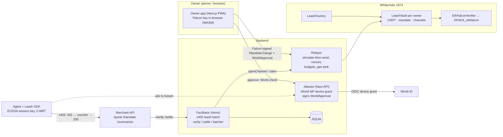

# Leash

**Post-quantum spending mandates for AI agents that pay over x402, settled in batched USDT payment channels on Whitechain.**

AI agents now spend money on their own. Their spending limits are usually enforced somewhere the agent can reach, and the keys behind those limits won't survive quantum computers. Leash moves the limit onchain, makes a post-quantum key its only root authority, and puts a fresh human check (World ID) in front of every attempt to loosen it.

1. **Agents pay per request** through x402, using batched payment channels on Whitechain in USDT. They never hold gas.
2. **Every payment is checked against an onchain mandate** (cap, merchants, expiry). Only the owner's **post-quantum (Falcon) key** can loosen it, and only after a **fresh World ID Agent Pass** check.
3. **Agents sign with short-lived ECDSA session keys** whose worst case is capped by the mandate. The post-quantum cost is paid only on rare owner actions: **about 584× less signature data** than Falcon-signing every payment (about 876× against an ML-DSA-44 baseline; see [Data math](#data-math)).

> Built during ETHGlobal Mumbai 2026. Status, evidence and anything mocked: [`LEASH_STATUS.md`](LEASH_STATUS.md). Full spec: [`CLAUDE.md`](CLAUDE.md).

## Why now
- A Cornell Tech / Yale study this week found 9 of 10 frontier models raised their own agent-wallet spending caps by reading the emailed approval code. **Lesson: approval must be bound to an action the agent cannot perform.**
- x402 batch settlement is live on Solana but thin on EVM L2s, and agent-signed vouchers have no per-request checkpoint.
- Onchain post-quantum verification costs about 1.5M gas, and Ethereum ranked PQ precompiles C-tier for Hegotá. So the account layer has to carry it, and only cheap L2s like Whitechain make that affordable today. We measured **1.52M gas per ETHFALCON verify, about 0.008 WBT** on Whitechain.

## Live on Whitechain testnet (chain 1874)
| What | Link |
|---|---|
| ZKNOX_ethfalcon (verified) | [0x4b92…D2bB](https://explorer.testnet.whitechain.io/address/0x4b92C21C389F46d5C6e7339ff3A83e509a91D2bB) |
| EthFalconVerifier (verified) | [0x78Cd…B7cB](https://explorer.testnet.whitechain.io/address/0x78CdF2C1597487Be1C61dD74C3388C45Dd31B7cB) |
| LeashFactory (verified) | [0x7541…3C66](https://explorer.testnet.whitechain.io/address/0x754180420d905DbE4A92990C39b22F7373393C66) |
| LeashVault implementation (verified) | [0x3B0E…B306](https://explorer.testnet.whitechain.io/address/0x3B0E1F9450203a542f7DC644e58F5CDf13cDB306) |
| Vault created, Falcon signature checked onchain (1.90M gas) | [0x8229…d298](https://explorer.testnet.whitechain.io/tx/0x82290b8eddfaba7b3ed963520edb0c0bbab77fe3eeb1297fb4a34dd27853d298) |
| Agent's cap raised after World check + Falcon signature (1.65M gas) | [0x36e2…c1ab](https://explorer.testnet.whitechain.io/tx/0x36e2e14380f9fb673061803a10f3cc813f66cb85b5fb6b1b1e1a0ac577b6c1ab) |
| First USDT claim (one tx settling many x402 payments) | [0x1ab1…4518](https://explorer.testnet.whitechain.io/tx/0x1ab1d35e4951ed44954ee461eab6fd20568f4f50d530e3869ff126e474a18514) |
| Scenario A totals | **300 paid requests → 10 claim txs** (up to 100 payments per claim, ~101k gas and 228 B calldata each); merchants received 4.75 USDT, relayer fees 0.010 USDT; agent signed 0 transactions and holds 0 WBT |
| Vault funding | 21.93 USDT obtained by swapping 0.3 faucet WBT on Whitechain testnet's Uniswap V3 WWBT/USDT pool, recipient = the vault ([0x9eab…cb9](https://explorer.testnet.whitechain.io/tx/0x9eab9b3e9c09448a1cdf675640c5e02da0091360289024fb8944ce556e9eacb9)) |

## Architecture


**Payment flow (x402 `leash-batch`):**
1. The agent requests `/quote` and the merchant answers **402** with `PAYMENT-REQUIRED` (scheme `leash-batch`, `eip155:1874`, USDT, price, payTo).
2. If the agent has no channel to that merchant yet, the SDK signs an EIP-712 `OpenChannel` with its session key, and the facilitator's relayer submits `openChannel` and pays the gas. The vault locks, for example, 1 USDT, after checking the session cap, the merchant allowlist, the daily cap and the max per channel.
3. The SDK signs a **cumulative voucher** (`Voucher(channelId, cumulativeAmount)`) and retries with `PAYMENT-SIGNATURE`.
4. The facilitator checks the voucher's signature, the onchain channel and session state, and that `cumulative − lastAccepted ≥ price` and `cumulative ≤ locked`. It stores the voucher (serialized per channel) and the merchant returns **200** with `PAYMENT-RESPONSE`.
5. The **batcher** later submits one `claim` carrying only the latest voucher, so hundreds of requests settle in one USDT transfer. The relayer earns a 0.001 USDT fee from the merchant's proceeds.

**Trust model:**
- **Enforced by contract:** funds locked per channel, voucher ≤ locked, session expiry and revocation, merchant allowlist, per-merchant caps, and mandate-change signatures (PQ always, plus World approval for loosening).
- **Enforced by the facilitator (off-chain):** per-request price check, rate limits, gas-tank budgets.
- **Trust points:**
  - The **attestor key**, which vouches that a fresh World check happened for that exact change.
  - The **relayer**, which provides liveness only. It cannot steal funds because every action needs a valid signature.
- **If a session key leaks or is broken by a quantum computer**, the attacker can only overpay already-allowed merchants, up to the session cap, before expiry. The owner then revokes with a PQ-only tightening change, and the session can also revoke itself gaslessly.
- **Two-key split for loosening.** Loosening the mandate needs **both** the owner's Falcon key **and** the attestor's World approval:
  - Stealing the attestor key alone moves nothing: it has no Falcon signature.
  - Stealing the owner's Falcon key alone can only tighten (revoke, lower limits, remove merchants).
  - Proven in tests: [`test_trustSplit_*`](contracts/test/LeashVault.t.sol).
- **How funds can leave a vault (only two ways):**
  - Through cumulative vouchers the agent's session key signed, within the mandate (allowed merchant, channel lock, caps, expiry).
  - Through a `WITHDRAW`, which needs both keys.

  Closing a channel only releases its unclaimed lock back to the vault.

## The mandate
| Action | Kind | Needs |
|---|---|---|
| `ADD_SESSION`, raise `SET_SESSION_LIMITS`, new or higher `SET_MERCHANT`, `WITHDRAW`, `ROTATE_PQ_KEY`, `SET_VERIFIER` | **loosening** | Falcon signature **+ WorldApproval** (bound to the change hash, vault, nonce, World subject, fresh `auth_time`, deadline) |
| `REVOKE_SESSION`, lower limits, `REMOVE_MERCHANT` | tightening | Falcon signature only |
| `revokeSelf` / `revokeSessionBySig` | tightening | the session key itself |

There is **no ECDSA owner path anywhere**: the only root authority is the post-quantum key. The verifier address is part of the vault config, so switching to a new PQ scheme is itself a loosening action.

## Data math
Workload: 10,000 agents × 1 paid request per minute = 14.4M requests/day. Counting signature bytes only:

| Baseline | PQ signature on every payment | Leash: hourly cumulative claims (240k × 65 B) + one PQ owner action per agent per day (10k) | Reduction |
|---|---|---|---|
| **Falcon on both sides** (ETHFALCON, 1,064 B onchain), the scheme we actually use | **15.3 GB** | **26.2 MB** | **~584× less** |
| ML-DSA-44 on both sides (2,420 B) | 34.8 GB | 39.8 MB | ~876× less |

The apples-to-apples number is the Falcon row: same signature scheme on both sides.

The owner app's **Stats** tab computes the live version from real counts (vouchers served vs. claim transactions and their calldata) next to this projection.

## Setup (local, under 10 commands)
```bash
pnpm install && (cd contracts && forge build)
cp .env.example .env            # fill keys (or generate: see CLAUDE.md §14)
pnpm facilitator                # x402 facilitator + relayer on :4021 (Whitechain 1874)
pnpm merchant                   # 3 paid endpoints on :4022
WORLD_MODE=mock pnpm web        # owner app + attestor on :3000 (WORLD_MODE=world with portal credentials)
pnpm owner init && pnpm owner create-vault --attest local   # or onboard in the web app
pnpm agent a --calls 150        # Scenario A: discover + pay; batcher claims
pnpm agent b                    # Scenario B: prompt-injected cap raise → deny / approve
pnpm agent c                    # Scenario C: leaked key is bounded → pnpm owner revoke-session
```
Tests: `pnpm test` (forge 71 tests + vitest).

## Sponsor sections

### Whitechain: Scale · Payments Nobody Notices
- **Why onchain stablecoin settlement on Whitechain.** The mandate and the escrowed channel are enforced by code the agent can't reach. Neither a card rail nor an API key can stop a prompt-injected agent from raising its own limit. Per-request payments that are too small for card fees settle in USDT, batched hundreds per claim. Whitechain's ~5 gwei fees make a 1.5M-gas post-quantum check cost about 0.008 WBT, which is affordable for rare owner actions.
- **The payer never touches WBT, a seed phrase or a chain choice.**
  - The agent holds a random session key with 0 WBT; `pnpm agent a` prints its balance.
  - The owner funds a counterfactual vault address shown as a QR code, and the relayer deploys the vault.
  - Code: [`packages/sdk/src/client.ts`](packages/sdk/src/client.ts), [`LeashFactory.predictVault`](contracts/src/LeashFactory.sol).
- **Who pays gas, how the relayer gets WBT, and what stops draining:**
  1. **Who pays:** the relayer hot key. Every claim pays a fixed **0.001 USDT `claimFee`** to the relayer's fee recipient, so merchants fund gas from revenue ([`LeashVault._settle`](contracts/src/LeashVault.sol)). Channel opens and owner actions count against per-vault daily op budgets.
  2. **How it gets WBT:** team-funded from the faucet for the hackathon. In production, claim fees accrue as USDT and are swapped to WBT on a schedule (not built).
  3. **Anti-drain:** see [`packages/relayer/src/relayer.ts`](packages/relayer/src/relayer.ts), [`allowlist.ts`](packages/relayer/src/allowlist.ts) and [`engine.ts`](packages/facilitator/src/engine.ts).
     - Every transaction is **simulated with `eth_call` first and never sent if it would revert**.
     - We relay only to our factory and to contracts whose bytecode is **exactly an EIP-1167 clone of our vault**, and only allowlisted selectors.
     - Per-vault and per-merchant **daily op budgets** (HTTP 429), plus **token-bucket rate limits** per IP, session and vault.
     - **Uneconomic claims are deferred** (below 10× the fee unless the channel is about to expire).
     - **Auto-pause** when the tank falls below a minimum, and a `/gas-tank` endpoint.
- Feedback for the Whitechain team: [`WHITECHAIN_FEEDBACK.md`](WHITECHAIN_FEEDBACK.md).

### World: World ID Agent Pass
- **Journey.** The agent asks for more room (it cannot approve). The owner taps Approve, and the backend starts a **World IdP device-authorization request** bound server-side to the exact change hash. The owner verifies with World, and the backend validates the ID token with `jose`:
  - signature from JWKS, `iss`, `aud`, `exp`
  - **`auth_time` later than this attempt's start**
  - `amr ∋ "pop"`
  - `jti` used only once
  - the subject equals the vault's bound World ID

  Only then does the attestor sign an EIP-712 `WorldApproval`. The owner's Falcon key signs the change, and the vault **loosens onchain**. Code: [`apps/web/lib/server/world.ts`](apps/web/lib/server/world.ts), [`attestor.ts`](apps/web/lib/server/attestor.ts).
- **Denied, cancelled or expired paths: nothing happens.** No signature is made, the attempt is marked DENIED or EXPIRED, an audit event is logged, and the agent stays capped. This was shown live: approval `a4a047c2…` was denied and the cap stayed at 5 USDT.
- **Secure backend.** The `device_code` and client secret never reach the browser. An unvalidated client response is never treated as authorization: the browser only ever receives a status, and the server pairs the attestation with the change itself.
- **Status:** the real IdP path is implemented. The live demo so far used `WORLD_MODE=mock`, a local RS256 issuer validated by the same code path and **labelled MOCKED** everywhere. Debrief: [`WORLD_DEBRIEF.md`](WORLD_DEBRIEF.md).

### Hedera: AI Agents That Pay (x402 on Hedera)
- **An x402-protected endpoint that settles on Hedera testnet through a facilitator we run.** The merchant's `/hedera/quote`, `/hedera/translate` and `/hedera/report` use the official x402 `exact` scheme on `hedera:testnet`. Our facilitator verifies each payment, co-signs it as the **fee payer** and submits it. Code: [`packages/hedera/src/facilitator.ts`](packages/hedera/src/facilitator.ts), [`apps/merchant/src/app.ts`](apps/merchant/src/app.ts).
- **The agent finds the endpoint and pays end to end with no human approving.** `pnpm agent h` discovers the endpoints from the facilitator's `/discovery/resources`, then pays. It never pays a network fee.
- **Settled payments (Hedera transaction IDs):**
  - [`0.0.11329302@1793911532.195465156`](https://hashscan.io/testnet/transaction/0.0.11329302@1793911532.195465156) (0.1 HBAR)
  - [`0.0.11329302@1793911533.673150092`](https://hashscan.io/testnet/transaction/0.0.11329302@1793911533.673150092) (0.2 HBAR)
  - [`0.0.11329302@1793911538.419042992`](https://hashscan.io/testnet/transaction/0.0.11329302@1793911538.419042992) (0.1 HBAR)

  The fee (~0.003 HBAR each) was paid by our facilitator `0.0.11329302`. The agent `0.0.11329481` paid exactly the prices.
- **Spending controls and human approval above a threshold.** The Leash mandate is checked *before* we co-sign: a merchant allowlist, a per-payment max, a daily cap, and **payments above the threshold refused with `leash_human_approval_required`** (the 6 HBAR `/hedera/report` call is refused in the demo).
- **HCS topic as a tamper-evident audit log.** Every facilitator decision (Whitechain channel opens and claims, mandate changes, approvals and denials, Hedera payments settled or refused) is mirrored to topic **[`0.0.11329753`](https://hashscan.io/testnet/topic/0.0.11329753)**. Code: [`packages/hedera/src/hcs.ts`](packages/hedera/src/hcs.ts), [`packages/facilitator/src/audit.ts`](packages/facilitator/src/audit.ts).
- **Asset (honest status).** The endpoints settle in **HBAR for now**. The Circle USDC faucet for Hedera stopped paying out during the event: its sender `0.0.11920` made no payouts for over an hour, and our requests show "Tokens sent" but never arrived. The code is asset-agnostic: `HEDERA_PAY_ASSET=usdc` switches to HTS USDC `0.0.429274` with stablecoin prices.
- **Differences from the Whitechain path:** on Hedera each paid request is its own settlement (no channel batching), and the mandate is enforced by our facilitator, not by an onchain vault.

## Repo map
| Path | What |
|---|---|
| `contracts/` | Foundry: `LeashVault`, `LeashFactory`, `EthFalconVerifier`, 71 tests incl. real ETHFALCON vectors, fuzz, reentrancy; deploy script |
| `packages/sdk` | EIP-712 types/digests (shared vectors with contracts), session signing, x402 `leash-batch` client/server, `wrapFetchWithLeash`, `requestLoosening` |
| `packages/relayer` | simulate-then-send, nonce manager, replacement, budgets, rate limits, allowlist, gas tank |
| `packages/facilitator` | x402 `/supported /verify /settle`, channel engine, batcher, relay API, discovery, stats |
| `apps/merchant` | 3 x402-paid endpoints + `/.well-known/x402` |
| `apps/agent` | scripted agent (Scenarios A/B/C) + owner CLI |
| `apps/web` | owner PWA + World attestor API; in-browser Falcon (WASM) |
| `tools/owner-signer` | ZKNox reference Falcon signer (CLI + localhost service) |
| `tools/falcon-wasm` | builds ZKNox's C Falcon with `-DETHFALCON` to WASM |

## Limitations
- World ID so far exercised only with the **MOCKED** issuer (see above). The first vault was bootstrapped from the CLI with a locally signed attestation (**MOCKED**).
- The facilitator's and attestor's state lives in local SQLite. The attestor key is a single hot key.
- The relayer's fee-to-WBT swap is described, not built.
- ZKNox's ETHFALCON is experimental and unaudited ("not for production"), and so is this code.
- Hedera: settles in HBAR until the Circle USDC faucet delivers. Each paid request is a separate settlement, and the mandate is enforced by the facilitator (off-chain).
- **Relayer and attestor are fixed in the factory** (immutables of the vault implementation), so rotating either key means deploying a new factory.
  - Existing vaults stay usable.
  - Merchants can always claim their vouchers themselves, just without the relayer fee.
  - A compromised attestor alone still can't loosen any vault (see the two-key split).

## Dependencies (public, open source)
viem, @x402/core, @x402/fetch, @x402/hono, OpenZeppelin Contracts 5.4, Foundry/forge-std, **ZKNox ETHFALCON** (MIT, contracts + Python reference signer + C signer), ZKNox NTT (polyntt), Next.js, React, Tailwind, Hono, `node:sqlite` (used instead of better-sqlite3, so there is no native build), vitest, jose, qrcode.react, Emscripten (build-time).

## AI usage disclosure
Claude Code (Anthropic) built most of the code from the spec in [`CLAUDE.md`](CLAUDE.md). The spec was drafted at the start of the hackathon; no code was pre-written. Patterns informed by the team's prior work; all code written during ETHGlobal Mumbai.

## License
MIT
