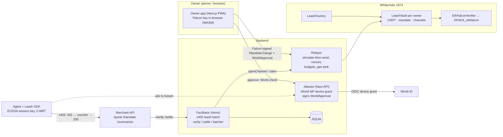

# Leash

**Post-quantum spending mandates for AI agents that pay over x402, settled in batched USDT payment channels on Whitechain.**

AI agents now spend money on their own. Their spending limits are usually enforced somewhere the agent can reach, and the keys behind those limits won't survive quantum computers. Leash moves the limit onchain, makes a post-quantum key its only root authority, and puts a fresh human check (World ID) in front of every attempt to loosen it.

1. **Agents pay per request** through x402, using batched payment channels on Whitechain in USDT. They never hold gas.
2. **Every payment is checked against an onchain mandate** (cap, merchants, expiry). Only the owner's **post-quantum (Falcon) key** can loosen it, and only after a **fresh World ID Agent Pass** check.
3. **Agents sign with short-lived ECDSA session keys** whose worst case is capped by the mandate. The post-quantum cost is paid only on rare owner actions: **about 584× less signature data** than Falcon-signing every payment (about 876× against an ML-DSA-44 baseline; see [Data math](#data-math)).

> Built during ETHGlobal Mumbai 2026. Status, evidence and anything mocked: [`LEASH_STATUS.md`](LEASH_STATUS.md). Full spec: [`CLAUDE.md`](CLAUDE.md).

## Why now
- A Cornell Tech / Yale study this week found 9 of 10 frontier models raised their own agent-wallet spending caps by reading the emailed approval code. **Lesson: approval must be bound to an action the agent cannot perform.**
- x402 batch settlement is live on Solana but thin on EVM L2s, and agent-signed vouchers have no per-request checkpoint.
- Onchain post-quantum verification costs about 1.5M gas, and Ethereum ranked PQ precompiles C-tier for Hegotá. So the account layer has to carry it, and only cheap L2s like Whitechain make that affordable today. We measured **1.52M gas per ETHFALCON verify, about 0.008 WBT** on Whitechain.

## Live on Whitechain testnet (chain 1874)
| What | Link |
|---|---|
| ZKNOX_ethfalcon (verified) | [0x4b92…D2bB](https://explorer.testnet.whitechain.io/address/0x4b92C21C389F46d5C6e7339ff3A83e509a91D2bB) |
| EthFalconVerifier (verified) | [0x78Cd…B7cB](https://explorer.testnet.whitechain.io/address/0x78CdF2C1597487Be1C61dD74C3388C45Dd31B7cB) |
| LeashFactory (verified) | [0x7541…3C66](https://explorer.testnet.whitechain.io/address/0x754180420d905DbE4A92990C39b22F7373393C66) |
| LeashVault implementation (verified) | [0x3B0E…B306](https://explorer.testnet.whitechain.io/address/0x3B0E1F9450203a542f7DC644e58F5CDf13cDB306) |
| Reproducible deploy record | [`contracts/deployments/1874.json`](contracts/deployments/1874.json): deploy txs, solc 0.8.25, `evm_version = cancun`, ZKNox `43ac863`, deployed from git commit `41ea8f9` (contract sources `ae2bcd2`). The live bytecode of all 4 contracts **exactly matches** a local build of that commit (immutables masked; `node scripts/record-deploy.mjs`) |
| **Live app** | **https://permissionless.in** (Cloudflare Tunnel → backend; see "Deploy") |
| **Vault created after a REAL World ID check** (World IdP sandbox, orb, browser flow) | [0x04dd…8d23](https://explorer.testnet.whitechain.io/tx/0x04dd758ae43fc97dc1354df60267ca6254ab7999571eef1252237412a0738d23) → vault [0x45A1…5F06](https://explorer.testnet.whitechain.io/address/0x45A14B41D527d2Ea138dcf86C3f60cD2d27c5F06) |
| **Agent's cap raised 5 → 8 after a REAL World ID check** + Falcon signature (1.65M gas) | [0xf714…28f9](https://explorer.testnet.whitechain.io/tx/0xf714cb0b65f62a3a2b9ee690fcbd00158fa9a68cf526bf5bb9a5866445ba28f9) |
| Vault created, Falcon signature checked onchain (1.90M gas; CLI vault, World **MOCKED**) | [0x8229…d298](https://explorer.testnet.whitechain.io/tx/0x82290b8eddfaba7b3ed963520edb0c0bbab77fe3eeb1297fb4a34dd27853d298) |
| Agent's cap raised after World check + Falcon signature (1.65M gas; World **MOCKED**) | [0x36e2…c1ab](https://explorer.testnet.whitechain.io/tx/0x36e2e14380f9fb673061803a10f3cc813f66cb85b5fb6b1b1e1a0ac577b6c1ab) |
| First USDT claim (one tx settling many x402 payments) | [0x1ab1…4518](https://explorer.testnet.whitechain.io/tx/0x1ab1d35e4951ed44954ee461eab6fd20568f4f50d530e3869ff126e474a18514) |
| Scenario A totals | **300 paid requests → 10 claim txs** (up to 100 payments per claim, ~101k gas and 228 B calldata each); merchants received 4.75 USDT, relayer fees 0.010 USDT; agent signed 0 transactions and holds 0 WBT |
| Vault funding | 21.93 USDT obtained by swapping 0.3 faucet WBT on Whitechain testnet's Uniswap V3 WWBT/USDT pool, recipient = the vault ([0x9eab…cb9](https://explorer.testnet.whitechain.io/tx/0x9eab9b3e9c09448a1cdf675640c5e02da0091360289024fb8944ce556e9eacb9)) |

## Architecture


**Payment flow (x402 `leash-batch`):**
1. The agent requests `/quote` and the merchant answers **402** with `PAYMENT-REQUIRED` (scheme `leash-batch`, `eip155:1874`, USDT, price, payTo).
2. If the agent has no channel to that merchant yet, the SDK signs an EIP-712 `OpenChannel` with its session key, and the facilitator's relayer submits `openChannel` and pays the gas. The vault locks, for example, 1 USDT, after checking the session cap, the merchant allowlist, the daily cap and the max per channel.
3. The SDK signs a **cumulative voucher** (`Voucher(channelId, cumulativeAmount)`) and retries with `PAYMENT-SIGNATURE`.
4. The facilitator checks the voucher's signature, the onchain channel and session state, and that `cumulative − lastAccepted ≥ price` and `cumulative ≤ locked`. It stores the voucher (serialized per channel) and the merchant returns **200** with `PAYMENT-RESPONSE`.
5. The **batcher** later submits one `claim` carrying only the latest voucher, so hundreds of requests settle in one USDT transfer. The relayer earns a 0.001 USDT fee from the merchant's proceeds.

**Trust model:**
- **Enforced by contract:** funds locked per channel, voucher ≤ locked, session expiry and revocation, merchant allowlist, per-merchant caps, and mandate-change signatures (PQ always, plus World approval for loosening).
- **Enforced by the facilitator (off-chain):** per-request price check, rate limits, gas-tank budgets.
- **Trust points:**
  - The **attestor key**, which vouches that a fresh World check happened for that exact change.
  - The **relayer**, which provides liveness only. It cannot steal funds because every action needs a valid signature.
- **If a session key leaks or is broken by a quantum computer**, the attacker can only overpay already-allowed merchants, up to the session cap, before expiry. The owner then revokes with a PQ-only tightening change, and the session can also revoke itself gaslessly.
- **Two-key split for loosening.** Loosening the mandate needs **both** the owner's Falcon key **and** the attestor's World approval:
  - Stealing the attestor key alone moves nothing: it has no Falcon signature.
  - Stealing the owner's Falcon key alone can only tighten (revoke, lower limits, remove merchants).
  - Proven in tests: [`test_trustSplit_*`](contracts/test/LeashVault.t.sol).
- **How funds can leave a vault (only two ways):**
  - Through cumulative vouchers the agent's session key signed, within the mandate (allowed merchant, channel lock, caps, expiry).
  - Through a `WITHDRAW`, which needs both keys.

  Closing a channel only releases its unclaimed lock back to the vault.

## The mandate
| Action | Kind | Needs |
|---|---|---|
| `ADD_SESSION`, raise `SET_SESSION_LIMITS`, new or higher `SET_MERCHANT`, `WITHDRAW`, `ROTATE_PQ_KEY`, `SET_VERIFIER` | **loosening** | Falcon signature **+ WorldApproval** (bound to the change hash, vault, nonce, World subject, fresh `auth_time`, deadline) |
| `REVOKE_SESSION`, lower limits, `REMOVE_MERCHANT` | tightening | Falcon signature only |
| `revokeSelf` / `revokeSessionBySig` | tightening | the session key itself |

There is **no ECDSA owner path anywhere**: the only root authority is the post-quantum key. The verifier address is part of the vault config, so switching to a new PQ scheme is itself a loosening action.

## Threat model: signing-pipeline and blind-signing attacks
Two kinds of large exchange losses came without the attacker ever holding a key:
- **Binance-style: the signing pipeline.** Valid keys sign whatever a compromised pipeline feeds them.
- **Bybit-style: the UI / blind signing.** In Feb 2025 the signers approved a transaction that a tampered wallet UI showed as routine (about $1.5B lost).

Leash's loosening path is a signing pipeline with a human in it, so it bounds both:

| Attacker controls | What they try | What stops or bounds it | Code |
|---|---|---|---|
| The **agent** (prompt injection, the Cornell scenario) | raise its own cap | It can only *ask* (`requestLoosening`). `applyChange` needs the owner's Falcon key + World approval | `LeashVault.applyChange`, Scenario B |
| The **attestor / approval pipeline** | feed the owner a different change, or approve a big one fast | **Two-key split** (onchain): the attestor alone can't loosen. The owner's device **recomputes the digest** and never signs a server-supplied hash. The **attestor policy** (F8.1) caps raises at 2× per 24 h, adds a daily ceiling and a cooldown on large withdrawals, and publishes every pending loosening to **HCS** before anyone approves it | `test_trustSplit_*`, `apps/web/lib/server/policy.ts` |
| The **owner's approval UI** (Bybit) | show one change, get a signature on another | **Two independent decoders** (F8.2): the attestor decodes the bytes behind `changeHash` server-side, and the device decodes the exact bytes it will sign. They sit side by side, and any **mismatch blocks** signing. The device signs only the byte-identical change that was reviewed | `apps/web/lib/server/decode.ts`, `canonicalChange` in `packages/sdk/src/actions.ts`, `DecodePanel.tsx` |
| The **owner's browser storage** | copy the Falcon key | The seed is **encrypted at rest** with a passkey-derived key (F8.3: WebAuthn PRF → HKDF → AES-256-GCM). It is decrypted only after user verification and auto-locks after 10 min | `apps/web/lib/client/passkey.ts` |
| A **large withdrawal** that slipped through | drain the vault | **Cooldown** (default 15 min) after the World check, before the attestor signs. **Deny** or any PQ-signed change (e.g. *Freeze all*) cancels it, because it bumps `mandateNonce` | `advanceCooldown` in `attestor.ts`, `apps/agent/src/f8-smoke.ts` |

**Residual risk (honest):**
- The attestor policy is **off-chain**. A fully compromised attestor could skip it, but it still needs the owner's Falcon signature over a change the owner's device decodes itself.
- Both decodings render in the same browser, so a **fully compromised owner device** can lie about both. What still holds:
  - World's personhood check
  - the policy limits per 24 h
  - the withdrawal cooldown
  - the HCS record
  - PQ-only tightening from any device that holds the backup

**Live evidence (Whitechain 1874, MOCKED World, scratch DB):**
- `f8-smoke.ts` passed 7/7 checks:
  - a 3× raise refused before the World check
  - a withdrawal held in cooldown, then cancelled by Deny
  - another cancelled by a PQ-only tightening ([tx](https://explorer.testnet.whitechain.io/tx/0x14b4fceb433cd9b8260142b454c22fc73680dff449475579bbe2281ebb1888a1))
  - a third signed only after the cooldown, and its submit refused after a later Deny
- The pending, blocked, cooldown and cancelled events are HCS messages #41–#49 on [topic 0.0.11329753](https://hashscan.io/testnet/topic/0.0.11329753).

## Post-quantum, live: PQ Ledger and the Q-Day drill
- **PQ Ledger** (owner app → **PQ** tab, `GET /facilitator/pq-ledger`) lists every transaction in which a Falcon-512 signature was verified onchain. Each signature and key is decoded from calldata, and the verify cost is measured by re-running it through the verifier. Today: **4 PQ-verified txs**, about **1.56M gas per Falcon verify (82–97% of each tx)**, against 300 payments that carried no PQ cost.
- **Q-Day drill** (`pnpm agent q`): the owner's post-quantum root is rotated live, **same vault, same money, new root of trust**.
  - `ROTATE_PQ_KEY` is loosening, so it needs a World approval plus a signature by the **old** key: [0x1c4f…a784](https://explorer.testnet.whitechain.io/tx/0x1c4fc9b384bad46fdf5d319f62af0011fecf52da918ada3d2b51f3844279a784). The World check was MOCKED for this run.
  - The retired key is then refused (`WrongPqKey`, simulated, never sent; re-test with `pnpm agent q --check`).
  - The new key signs its first tightening change: [0x8543…113e](https://explorer.testnet.whitechain.io/tx/0x8543b2c0be8a95ff9a68ee32ed0c811218f5e4d07ed51061db6c51761f8f113e).
  - The vault balance (17.171374 USDT) was unchanged throughout. The forge test `test_rotatePqKey_oldKeyStopsWorking` covers the same property.
- **Crypto-agility:** the verifier address is vault config. A loosening `SET_VERIFIER` change (Falcon signature plus World approval) can move a vault to ML-DSA or a future precompile **without migrating funds**.

## Automatic containment: the circuit breaker
Tightening is safe to automate, so Leash does it automatically.
- **Triggers:** the facilitator watches every vault for swarm behaviour:
  - payment velocity per session
  - channel fan-out
  - many parallel sessions
  - repeated mandate-change attempts
- **On a trip:**
  - every voucher and channel open from that vault is refused (`leash_circuit_open`)
  - the incident is written to the HCS audit log
  - the owner gets a one-tap **Freeze all**: a batch `REVOKE_SESSION`, which needs only the Falcon key, no World check
- **Never blocked:** owner changes. Anything may tighten; only loosening needs a human.
- **Live (Scenario D, `pnpm agent d`):** 20 self-cloned copies of a compromised agent were cut off **271 ms** after the burst began (151 requests from one session in 10 s). HCS [topic 0.0.11329753](https://hashscan.io/testnet/topic/0.0.11329753), message #11 `CircuitTripped`.
- The breaker is enforced by the facilitator (off-chain), with HCS as the audit anchor. The onchain caps still bound the worst case if the facilitator were bypassed.
- Code: [`packages/facilitator/src/breaker.ts`](packages/facilitator/src/breaker.ts); 7 vitest cases.

## Agent flight recorder (tamper-evident activity log)
- **What's logged:** every accepted payment becomes a leaf `keccak(requestId, keccak(resourceUrl), cumulative, timestamp)`.
- **What's published:** every claim publishes the **Merkle root** of that channel's new leaves to the HCS audit topic. Only hashes leave the facilitator, never content.
- **How to check:** `pnpm verify-log [channelId]` recomputes every root from the facilitator's SQLite and compares it with Hedera's mirror node. Editing or deleting a single stored row breaks it (5 vitest cases).
- **Live:** 3/3 flight records match HCS topic [0.0.11329753](https://hashscan.io/testnet/topic/0.0.11329753). The first covers claim [0x158e…e2e0](https://explorer.testnet.whitechain.io/tx/0x158e0058f3bd3715287f07f66fe10f2d2c6202ff97dcb393a8b9f7c58843e2e0).
- Code: [`packages/facilitator/src/flight.ts`](packages/facilitator/src/flight.ts).

## Reorg safety
L2s can roll back blocks, so a pay-per-request rail must survive a vanished claim without double-paying or losing merchant revenue.
- **Why it's safe:** vouchers are **cumulative and idempotent**. The vault pays only `cumulative − claimed` and requires `cumulative > claimed`, so re-submitting the latest voucher can never pay twice.
- **What the facilitator does:** before every batch it reconciles recent claims against the chain. If a claim tx is gone, it rolls its bookkeeping back to the onchain `claimed`, resyncs the relayer nonce, logs `ClaimReorged` (SQLite + HCS), and claims the latest voucher again.
- **Proven on anvil** with `evm_snapshot` / `evm_revert` ([`packages/facilitator/test/e2e.test.ts`](packages/facilitator/test/e2e.test.ts), "F3 reorg safety"):
  1. claim → the merchant receives 0.099 USDT
  2. rollback → the merchant is back to the previous balance
  3. reconcile + re-claim → the merchant receives 0.099 USDT once
  4. another batch → nothing more to claim

## Data math
Workload: 10,000 agents × 1 paid request per minute = 14.4M requests/day. Counting signature bytes only:

| Baseline | PQ signature on every payment | Leash: hourly cumulative claims (240k × 65 B) + one PQ owner action per agent per day (10k) | Reduction |
|---|---|---|---|
| **Falcon on both sides** (ETHFALCON, 1,064 B onchain), the scheme we actually use | **15.3 GB** | **26.2 MB** | **~584× less** |
| ML-DSA-44 on both sides (2,420 B) | 34.8 GB | 39.8 MB | ~876× less |

The apples-to-apples number is the Falcon row: same signature scheme on both sides.

The owner app's **Stats** tab computes the live version from real counts (vouchers served vs. claim transactions and their calldata) next to this projection.

## Setup (local, under 10 commands)
```bash
pnpm install && (cd contracts && forge build)
cp .env.example .env            # fill keys (or generate: see CLAUDE.md §14)
pnpm facilitator                # x402 facilitator + relayer on :4021 (Whitechain 1874)
pnpm merchant                   # 3 paid endpoints on :4022
WORLD_MODE=mock pnpm web        # owner app + attestor on :3000 (WORLD_MODE=world with portal credentials)
pnpm owner init && pnpm owner create-vault --attest local   # or onboard in the web app
pnpm agent a --calls 150        # Scenario A: discover + pay; batcher claims
pnpm agent b                    # Scenario B: prompt-injected cap raise → deny / approve
pnpm agent c                    # Scenario C: leaked key is bounded → pnpm owner revoke-session
```
Tests: `pnpm test` (forge 71 tests + vitest).

## Sponsor sections

### Whitechain: Scale · Payments Nobody Notices
- **Why onchain stablecoin settlement on Whitechain.** The mandate and the escrowed channel are enforced by code the agent can't reach. Neither a card rail nor an API key can stop a prompt-injected agent from raising its own limit. Per-request payments that are too small for card fees settle in USDT, batched hundreds per claim. Whitechain's ~5 gwei fees make a 1.5M-gas post-quantum check cost about 0.008 WBT, which is affordable for rare owner actions.
- **The payer never touches WBT, a seed phrase or a chain choice.**
  - The agent holds a random session key with 0 WBT; `pnpm agent a` prints its balance.
  - The owner funds a counterfactual vault address shown as a QR code, and the relayer deploys the vault.
  - Code: [`packages/sdk/src/client.ts`](packages/sdk/src/client.ts), [`LeashFactory.predictVault`](contracts/src/LeashFactory.sol).
- **Who pays gas, how the relayer gets WBT, and what stops draining:**
  1. **Who pays:** the relayer hot key. Every claim pays a fixed **0.001 USDT `claimFee`** to the relayer's fee recipient, so merchants fund gas from revenue ([`LeashVault._settle`](contracts/src/LeashVault.sol)). Channel opens and owner actions count against per-vault daily op budgets.
  2. **How it gets WBT:** team-funded from the faucet for the hackathon. In production, claim fees accrue as USDT and are swapped to WBT on a schedule (not built).
  3. **Anti-drain:** see [`packages/relayer/src/relayer.ts`](packages/relayer/src/relayer.ts), [`allowlist.ts`](packages/relayer/src/allowlist.ts) and [`engine.ts`](packages/facilitator/src/engine.ts).
     - Every transaction is **simulated with `eth_call` first and never sent if it would revert**.
     - We relay only to our factory and to contracts whose bytecode is **exactly an EIP-1167 clone of our vault**, and only allowlisted selectors.
     - Per-vault and per-merchant **daily op budgets** (HTTP 429), plus **token-bucket rate limits** per IP, session and vault.
     - **Uneconomic claims are deferred** (below 10× the fee unless the channel is about to expire).
     - **Auto-pause** when the tank falls below a minimum, and a `/gas-tank` endpoint.
- Feedback for the Whitechain team: [`WHITECHAIN_FEEDBACK.md`](WHITECHAIN_FEEDBACK.md).

### World: World ID Agent Pass
- **Journey.** The agent asks for more room (it cannot approve). The owner taps Approve, and the backend starts a **World IdP request** bound server-side to the exact change hash. This is the authorization-code + PKCE flow with our callback `/api/world/callback`; the device grant is also implemented. The owner verifies with World, and the backend validates the ID token with `jose`:
  - signature from JWKS, `iss`, `aud`, `exp`
  - **`auth_time` later than this attempt's start**
  - `amr ∋ "pop"`
  - `jti` used only once
  - the subject equals the vault's bound World ID

  Only then does the attestor sign an EIP-712 `WorldApproval`. The owner's Falcon key signs the change, and the vault **loosens onchain**. Code: [`apps/web/lib/server/world.ts`](apps/web/lib/server/world.ts), [`attestor.ts`](apps/web/lib/server/attestor.ts).
- **Denied, cancelled or expired paths: nothing happens.** No signature is made, the attempt is marked DENIED or EXPIRED, an audit event is logged, and the agent stays capped. This was shown live: approval `a4a047c2…` was denied and the cap stayed at 5 USDT.
- **Secure backend.** The `device_code` and client secret never reach the browser. An unvalidated client response is never treated as authorization: the browser only ever receives a status, and the server pairs the attestation with the change itself.
- **Status: live with the real World IdP (sandbox).**
  - Vault [0x45A1…5F06](https://explorer.testnet.whitechain.io/address/0x45A14B41D527d2Ea138dcf86C3f60cD2d27c5F06) was **created after a real World check** ([tx](https://explorer.testnet.whitechain.io/tx/0x04dd758ae43fc97dc1354df60267ca6254ab7999571eef1252237412a0738d23)).
  - Scenario B ran on it end to end:
    1. The agent's own `applyChange` reverts.
    2. A 500 USDT ask is blocked by the attestor policy.
    3. An 8 USDT ask the owner **denied** (nothing signed).
    4. An 8 USDT ask the owner **approved** with a fresh real World check → cap 5 → 8 ([tx](https://explorer.testnet.whitechain.io/tx/0xf714cb0b65f62a3a2b9ee690fcbd00158fa9a68cf526bf5bb9a5866445ba28f9)).
  - Real `access_denied` and expired attempts also signed nothing.
  - The older CLI vault used `WORLD_MODE=mock` (a local RS256 issuer, same validation code, **labelled MOCKED**).
  - Debrief: [`WORLD_DEBRIEF.md`](WORLD_DEBRIEF.md).

### Hedera: AI Agents That Pay (x402 on Hedera)
- **An x402-protected endpoint that settles on Hedera testnet through a facilitator we run.** The merchant's `/hedera/quote`, `/hedera/translate` and `/hedera/report` use the official x402 `exact` scheme on `hedera:testnet`. Our facilitator verifies each payment, co-signs it as the **fee payer** and submits it. Code: [`packages/hedera/src/facilitator.ts`](packages/hedera/src/facilitator.ts), [`apps/merchant/src/app.ts`](apps/merchant/src/app.ts).
- **The agent finds the endpoint and pays end to end with no human approving.** `pnpm agent h` discovers the endpoints from the facilitator's `/discovery/resources`, then pays. It never pays a network fee.
- **Settled in an HTS token (tUSDC `0.0.11337141`, self-issued test stablecoin, mentor-approved):**
  - [`0.0.11329302@1793957494.767070888`](https://hashscan.io/testnet/transaction/0.0.11329302@1793957494.767070888) (0.01 tUSDC)
  - [`0.0.11329302@1793957501.975002527`](https://hashscan.io/testnet/transaction/0.0.11329302@1793957501.975002527) (0.02 tUSDC)
  - [`0.0.11329302@1793957503.990274487`](https://hashscan.io/testnet/transaction/0.0.11329302@1793957503.990274487) (0.01 tUSDC)

  The 0.6 tUSDC report was refused (`leash_human_approval_required`). The agent's HBAR stayed at 19.3, because our facilitator paid every fee.
- **Earlier settlements in HBAR (before the token existed):**
  - [`0.0.11329302@1793911532.195465156`](https://hashscan.io/testnet/transaction/0.0.11329302@1793911532.195465156) (0.1 HBAR)
  - [`0.0.11329302@1793911533.673150092`](https://hashscan.io/testnet/transaction/0.0.11329302@1793911533.673150092) (0.2 HBAR)
  - [`0.0.11329302@1793911538.419042992`](https://hashscan.io/testnet/transaction/0.0.11329302@1793911538.419042992) (0.1 HBAR)

  The fee (~0.003 HBAR each) was paid by our facilitator `0.0.11329302`. The agent `0.0.11329481` paid exactly the prices.
- **Spending controls and human approval above a threshold.** The Leash mandate is checked *before* we co-sign: a merchant allowlist, a per-payment max, a daily cap, and **payments above the threshold refused with `leash_human_approval_required`** (the 6 HBAR `/hedera/report` call is refused in the demo).
- **HCS topic as a tamper-evident audit log.** Every facilitator decision (Whitechain channel opens and claims, mandate changes, approvals and denials, Hedera payments settled or refused) is mirrored to topic **[`0.0.11329753`](https://hashscan.io/testnet/topic/0.0.11329753)**. Code: [`packages/hedera/src/hcs.ts`](packages/hedera/src/hcs.ts), [`packages/facilitator/src/audit.ts`](packages/facilitator/src/audit.ts).
- **Asset (honest status).** The Circle USDC faucet for Hedera never paid out during the event (sender `0.0.11920` stalled). With the mentors' OK we issued our own HTS test stablecoin with `pnpm hedera:token` (tUSDC `0.0.11337141`; treasury = our operator; memo "not Circle USDC"). The code is asset-agnostic: `HEDERA_USDC_TOKEN_ID` selects the token (Circle's `0.0.429274` or ours), and `HEDERA_PAY_ASSET=hbar` falls back to HBAR.
- **Differences from the Whitechain path:** on Hedera each paid request is its own settlement (no channel batching), and the mandate is enforced by our facilitator, not by an onchain vault.

## Try it yourself (live, testnet)
Open **https://permissionless.in** on your phone.
1. **Setup:** create the in-browser key, keep the default limits (the demo agent, 5 USDT), verify with World ID, then create the vault. Leash pays the gas.
2. **Limits → Try it with the demo agent:**
   - **Get 2 test USDT** is a testnet faucet: once per vault, capped per day.
   - **Let the agent pay for 20 API calls** makes real x402 payments, settled on Whitechain.
   - **Agent asks for more** files a request in Requests. Approve it with World ID, or deny it.
   - **Injected agent** sends the Cornell-style 500 USDT ask. The safety policy blocks it before any World check.
3. **Freeze all** revokes the agent with your key alone, after which the agent can't pay.

## Use Leash from any AI agent (MCP)
`apps/mcp` is an MCP server: any MCP-capable assistant (Claude Desktop, Claude Code, Cursor, …) can pay x402 APIs from a Leash vault, and can try to break its limits.
- **Tools:**
  - `leash_whoami`, `check_budget`, `list_services`
  - `buy_service` (pays per call in USDT)
  - `request_more_budget` / `check_request` (the owner decides with World ID)
  - `change_my_limits` and `pay_address`: the moves a hacked agent would try
- **Enforcement:** every refusal comes from the vault contract or facilitator and is returned verbatim, not from a prompt.
- **Setup:**
  1. The first run creates a session key in `~/.leash/agent-key.json` (0600). It never holds gas.
  2. `--print-address` shows the agent's address. The owner adds it in the app: **Limits → Add an agent**, one World ID scan.
  3. Point the assistant at it, for example:
     `claude mcp add leash -e LEASH_VAULT=0x… -- node apps/mcp/node_modules/tsx/dist/cli.mjs apps/mcp/src/server.ts`
- **Live smoke test** (`apps/mcp/scripts/smoke.ts`, a real MCP client over stdio):
  - bought a USD/INR quote for 0.01 USDT
  - `pay_address(0x…dEaD)` → blocked `MerchantNotAllowed`
  - `change_my_limits(500)` → blocked `WrongPqKey`

## Partner API (e.g. the Break-the-Leash arena)
- **Hosts:** `https://facilitator.permissionless.in` (x402 facilitator + discovery) and `https://merchant.permissionless.in` (paid endpoints). CORS is open.
- **`x-api-key` lane:**
  - Set the keys with `LEASH_API_KEYS="name:secret,…"`, or `ARENA_API_KEY`.
  - Requests with a valid key (e.g. `/channels/open`) get their own rate-limit bucket. The default is a burst of 60, then 2/s (`API_OPEN_BURST` / `API_OPEN_PER_SEC`), instead of the shared per-IP one.
  - A wrong key gets 401. Per-vault limits and every onchain check still apply.
- **`GET /stats?vault=0x…`** returns per-vault counters: channels (open/locked), vouchers served, committed vs claimed, claims (count, paid to merchants, fees, latest txs), per-session breakdown, audit-event counts, and breaker state.

## Deploy (live link)
- **https://permissionless.in** runs through a Cloudflare Tunnel to the backend host, which runs the owner app + attestor, the facilitator and the merchant.
- How to run it on any server: [`deploy/cloudflare/README.md`](deploy/cloudflare/README.md). The VPS alternative (Caddy + pm2) is in [`deploy/`](deploy/).

## Repo map
| Path | What |
|---|---|
| `contracts/` | Foundry: `LeashVault`, `LeashFactory`, `EthFalconVerifier`, 71 tests incl. real ETHFALCON vectors, fuzz, reentrancy; deploy script |
| `packages/sdk` | EIP-712 types/digests (shared vectors with contracts), session signing, x402 `leash-batch` client/server, `wrapFetchWithLeash`, `requestLoosening` |
| `packages/relayer` | simulate-then-send, nonce manager, replacement, budgets, rate limits, allowlist, gas tank |
| `packages/facilitator` | x402 `/supported /verify /settle`, channel engine, batcher, relay API, discovery, stats |
| `apps/merchant` | 3 x402-paid endpoints + `/.well-known/x402` |
| `apps/agent` | scripted agent (Scenarios A/B/C) + owner CLI |
| `apps/web` | owner PWA + World attestor API; in-browser Falcon (WASM) |
| `tools/owner-signer` | ZKNox reference Falcon signer (CLI + localhost service) |
| `tools/falcon-wasm` | builds ZKNox's C Falcon with `-DETHFALCON` to WASM |

## Limitations
- World ID runs against the **real World IdP sandbox**, with fake identities by World's design ("Sandbox: uses fake identities"). The first (CLI) vault and its drills were bootstrapped with the **MOCKED** local issuer.
- The facilitator's and attestor's state lives in local SQLite. The attestor key is a single hot key.
- The relayer's fee-to-WBT swap is described, not built.
- The **attestor policy (F8.1) is off-chain**: the attestor enforces it, not the contract. Its 24 h history lives in the attestor's SQLite and counts a loosening as soon as the attestor signs, even if it is never submitted. Defaults: 2× per 24 h, 100 USDT/day, a 15 min cooldown above 5 USDT; all set through `POLICY_*` env.
- **Passkey encryption (F8.3)** needs the WebAuthn PRF extension: Chrome/Edge 116+ or Safari 18+, with a PRF-capable passkey. Without it the Falcon seed stays unencrypted in IndexedDB, and the app says so. Safari may need the unlock to happen right on a tap.
- ZKNox's ETHFALCON is experimental and unaudited ("not for production"), and so is this code.
- Hedera settles in **tUSDC, our self-issued HTS test stablecoin** ([`0.0.11337141`](https://hashscan.io/testnet/token/0.0.11337141), 6 decimals; mentor-approved because the Circle faucet never paid out). It is **not Circle USDC**. Each paid request is a separate settlement, and the mandate is enforced by the facilitator (off-chain).
- The live link runs the backend on a laptop behind a Cloudflare Tunnel. The approvals inbox endpoints (file / deny) are not owner-authenticated, so a stranger could deny a pending request (griefing). They can never approve one, since that needs World + the Falcon key.
- **Relayer and attestor are fixed in the factory** (immutables of the vault implementation), so rotating either key means deploying a new factory.
  - Existing vaults stay usable.
  - Merchants can always claim their vouchers themselves, just without the relayer fee.
  - A compromised attestor alone still can't loosen any vault (see the two-key split).

## Dependencies (public, open source)
viem, @x402/core, @x402/fetch, @x402/hono, OpenZeppelin Contracts 5.4, Foundry/forge-std, **ZKNox ETHFALCON** (MIT, contracts + Python reference signer + C signer), ZKNox NTT (polyntt), Next.js, React, Tailwind, Hono, `node:sqlite` (used instead of better-sqlite3, so there is no native build), vitest, jose, qrcode.react, Emscripten (build-time). UI: shadcn/ui components (MIT, copied into `apps/web/components/ui`), Radix UI, lucide-react, sonner, `cn`, class-variance-authority, tw-animate-css, Geist / Geist Mono fonts. Hedera: @hiero-ledger/sdk, @x402/hedera. MCP: @modelcontextprotocol/sdk, zod.

## AI usage disclosure
Claude Code (Anthropic) built most of the code from the spec in [`CLAUDE.md`](CLAUDE.md). The spec was drafted at the start of the hackathon; no code was pre-written. Patterns informed by the team's prior work; all code written during ETHGlobal Mumbai.

## License
MIT
